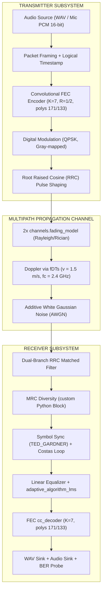

# Technical Specification & Project Plan: Ultra-Low Latency Wireless Audio Link

> [!info] Project Metadata
> - **Course**: `61ECE314` — Mobile Communications (Winter Semester 2026/2027)  
> - **Academic Advisor**: Dr. Nguyen Tuan Khanh  
> - **Project Title**: **Design and Simulation of an Ultra-Low Latency Digital Wireless In-Ear Monitor (IEM) Transceiver with Diversity Reception and Adaptive Equalization over Multipath Fading Channels in GNU Radio**  
> - **Team Composition (3 Members)**: Thuy Tien, Nguyen Huynh Van Phuong, Quang Thien  
> - **Progress Tracker**: [`MCOM_Project_Progress_Tracker.xlsx`](MCOM_Project_Progress_Tracker.xlsx)  
> - **Target Delivery Window**: 14/11/2026 – 09/12/2026 (Lecture 11: 09/12/2026 and Lecture 12: 16/12/2026)  
> - **Toolchain Verified**: GNU Radio **3.10.12.0** (`C:\ProgramData\radioconda`, Python 3.12)  

---

## 1. System Architecture and Technical Specifications

### Key Performance Metrics

| Chỉ số | Định nghĩa / Ngưỡng | Ghi chú |
| :--- | :--- | :--- |
| Độ trung thực audio | PCM 48 kHz, 16-bit, không nén | đường demo chính dùng WAV |
| **Latency thuật toán** | $T_{\text{alg}} = T_{\text{framing}} + T_{\text{FEC}} + T_{\text{RRC}} + T_{\text{sync}} + T_{\text{EQ}} + T_{\text{buf}} \le 5.0$ ms | **Đo trong miền mô phỏng, LOẠI TRỪ soundcard I/O.** Ngân sách chi tiết ở mục 4.4 master plan |
| Điều chế & băng thông | QPSK Gray-mapped, `sps` = 4, $\alpha = 0.35$, $R_s$ = 12 ksym/s | π/4-DQPSK đã cắt khỏi scope |
| Tăng ích phân tập | MRC 2 nhánh: $> 3$ dB tại $BER = 10^{-3}$ | đo 1 nhánh vs 2 nhánh |
| Coding gain FEC | $\ge 2$ dB tại $BER = 10^{-4}$ | K=7, R=1/2, đa thức 171/133 |
| Throughput mô phỏng | $\ge 1$ Mbit/s | đã đo 1,03 Mbit/s |

> [!warning] Bẫy môi trường
> `python` mặc định của hệ điều hành là 3.15.2 và **không có** GNU Radio. Mọi script phải chạy bằng `C:\ProgramData\radioconda\python.exe`.

---

## 2. Execution Roadmap and Submission Gates

> [!info] Status Notice (17/11/2026)
> Lịch thuyết trình Final Project được xác lập chính thức theo Slide bài giảng của Giáo viên (Lecture 0, Slide 8 & 10):
> - **Buổi 11 (Lecture 11 — 09/12/2026)**: Đợt thuyết trình Final Project 1 (hoặc Invited talk) — 20 min presentation, 10 min Q&A.
> - **Buổi 12 (Lecture 12 — 16/12/2026)**: Đợt thuyết trình Final Project 2 (Buổi kết thúc môn học).
> - **Chiến lược sẵn sàng bảo vệ**: Nhóm nén timeline để đạt trạng thái **Code & Report Freeze vào 08/12/2026**, sẵn sàng báo cáo ngay từ Buổi 11 (09/12/2026). Nếu được xếp bảo vệ Buổi 12 (16/12/2026), tuần 09–16/12 sẽ đóng vai trò **Extended Defense Buffer**.

| Gate | Ngày | Trọng tâm | Deliverable | Lead Owners | Trạng thái |
| :---: | :---: | :--- | :--- | :---: | :---: |
| **GATE-1** | 23/09/2026 | Đăng ký đề tài trên Google Sheet GV | Đề tài được duyệt | Vân Phương | Completed |
| **GATE-2** | 18/11/2026 | Baseband framing + smoke flowgraph chạy headless | Flowgraph v1.0 (.grc) + smoke test | Vân Phương | Completed |
| **GATE-3** | **24/11/2026** | QPSK Modem, RRC, Symbol Sync, Costas, Viterbi FEC + **Testbed `ber_sweep.py`** | Flowgraph v2.0 + `ber_sweep.py` + BER(AWGN) curve | Quang Thiện & Thùy Tiên | In Progress |
| **GATE-4** | **30/11/2026** | 2 nhánh Rayleigh (`fDTs`), **MRC Python Block** + **Doppler Sweeps** | Flowgraph v3.0 + `mrc_diversity_block.py` + Diversity curves | Vân Phương & Thùy Tiên | Upcoming |
| **GATE-5** | **05/12/2026** | Linear Equalizer (LMS), Latency Budget + **QT GUI Dashboard** | Flowgraph v4.0 + Bảng latency budget + QT Dashboard | Vân Phương & Thùy Tiên | Upcoming |
| **GATE-6** | **08/12/2026** | Report XeLaTeX IEEE + Slide 20 phút + Video Demo A/B | PDF Report + Slide Deck + Video Demo | All 3 (Vân Phương: Report, Thùy Tiên: Slides & Video, Quang Thiện: Integration) | Upcoming |
| **BUFFER** | **08/12/2026** | Code freeze + tổng duyệt demo & slide trước Buổi 11 | Bản demo & slide ổn định | All 3 | Buffer |
| **DEFENSE 1** | **09/12/2026** | **Thuyết trình Buổi 11 (Lecture 11)** theo slide GV | Báo cáo 20' + Q&A 10' | All 3 | Milestone |
| **DEFENSE 2** | **16/12/2026** | **Thuyết trình Buổi 12 (Lecture 12)** theo slide GV | Báo cáo 20' + Q&A 10' | All 3 | Milestone |

> [!note] Điều chỉnh theo lịch Slide GV
> GATE-4 chốt 30/11, GATE-5 chốt 05/12, GATE-6 hoàn tất 08/12 để đảm bảo 100% sẵn sàng trước đợt thuyết trình Buổi 11 (09/12/2026). Tuần 09–16/12 là Extended Buffer nếu nhóm bảo vệ ở Buổi 12.

---

## 3. Team Responsibility Breakdown

| Thành viên | Trọng tâm Kỹ thuật | Trách nhiệm & Deliverable chính |
| :--- | :--- | :--- |
| **Nguyễn Huỳnh Vân Phương** | **Core Mobile Telecom Algorithms, Diversity Combining & Equalization** | • GATE-1 & GATE-2 (Đã hoàn thành 100%): Audio framing, `pcm_framing.py`, `smoke_test_baseband.py`. • **GATE-4 (MCOM-05)**: 2 nhánh Rayleigh Fading, Doppler `fDTs`, viết **MRC Python Custom Block** (`mrc_diversity_block.py`). • **GATE-5 (MCOM-07)**: Khối cân bằng **LMS Linear Equalizer** triệt ISI. • **Bảng ngân sách độ trễ thuật toán** ($T_{\text{alg}} \approx 3.4\text{ ms} \le 5.0\text{ ms}$) + impulse/tag probe. • **MCOM-09**: Chủ trì soạn thảo Báo cáo kỹ thuật IEEE XeLaTeX 2 cột (lý thuyết, kiến trúc, phân tích giải thuật). |
| **Quang Thiện** | **Digital Modem Transceiver & Forward Error Correction Subsystem** | • **GATE-3 (MCOM-03)**: QPSK Gray-mapped, lọc phát/thu Tx/Rx RRC, khóa đồng bộ **Symbol Sync (`TED_GARDNER`)** và **Costas Loop**. • Mã hóa Convolutional FEC ($K=7, R=1/2$) và giải mã Viterbi `cc_decoder`. • Xây dựng và tích hợp **Flowgraph v2.0 (`rf_qpsk_link.grc`)**. • Hỗ trợ tích hợp khối MRC của Vân Phương và Dashboard của Thùy Tiên vào flowgraph tổng thể (v3.0/v4.0). |
| **Thùy Tiên** | **Automated Measurement Testbed, QT GUI Dashboard, Soundcard Testing & Defense Media** | • **GATE-3 (MCOM-04)**: Xây dựng testbed chạy headless tự động **`ber_sweep.py`** đo đường cong BER trên kênh AWGN, đối soát lý thuyết $Q(\sqrt{2E_b/N_0})$. • **GATE-4 (MCOM-06)**: Xây dựng script sweep tự động **`fading_benchmark.py`** đo BER vs SNR trên kênh fading Rayleigh qua 3 dải Doppler ($v = 0.15, 1.5, 15\text{ m/s}$); vẽ biểu đồ so sánh 1 nhánh vs 2 nhánh MRC, xác nhận tăng ích phân tập $\ge 3\text{ dB}$. • **GATE-5 (MCOM-08)**: Thiết kế giao diện **QT GUI Dashboard** (Constellation, phổ FFT, bộ đếm tỷ lệ mất gói) và thực hiện bài test kiểm thử âm thanh phần cứng trên laptop/máy chiếu (`audio.sink` vs fallback `wavfile_sink`). • **GATE-6 (MCOM-09)**: **Chủ trì thiết kế Slide thuyết trình 20 phút** chuẩn IEEE và **Quay Video Demo chính thức** với so sánh âm thanh A/B. |

### 3.1 Ba câu hỏi cần chốt với GVHD

1. Demo có được dùng **kênh mô phỏng** (`channels.fading_model`) thay vì RF/SDR thật không?
2. **"< 5 ms"** đo theo nghĩa nào — latency thuật toán (miền mô phỏng) hay end-to-end qua soundcard?
3. Tiêu chí chấm demo: cần **audio nghe được**, hay chỉ cần **BER curve + constellation**?
